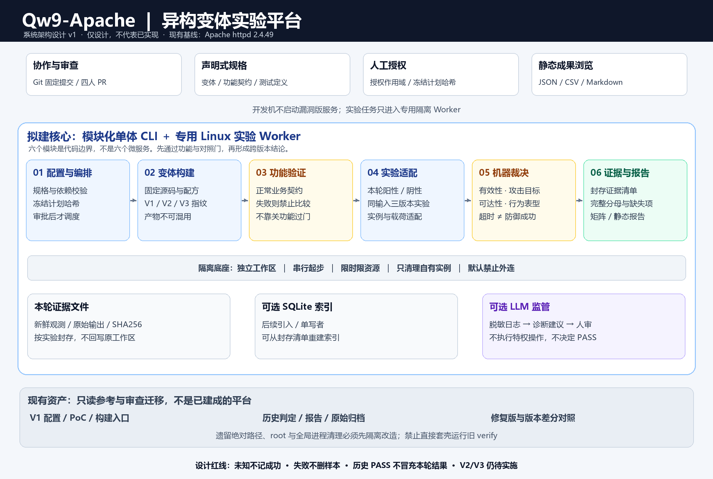
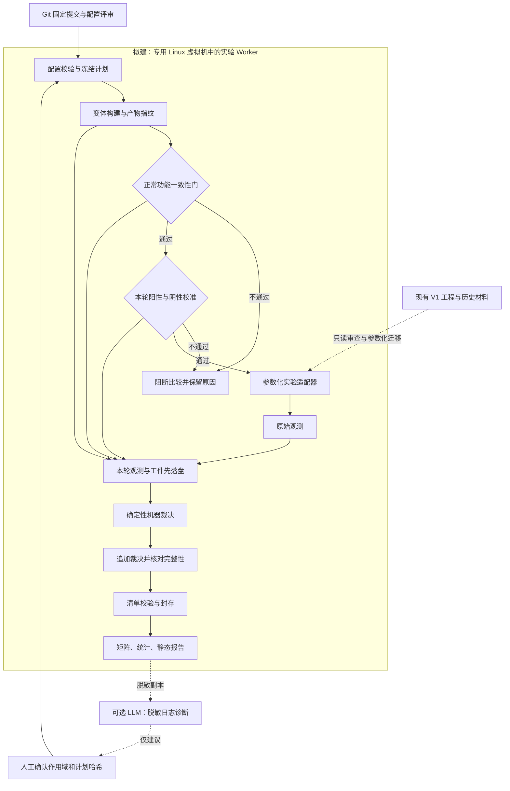

# Qw9-Apache 系统架构设计 v1

> **已被 [v2](Qw9-Apache-系统架构设计-v2.md) 取代。** v1 把两项核心创新（LLM 监管 Agent、可复现性熵）降级为可选能力，并遗漏了类型分派、互补性筛选、原语指纹、拟态网关/多阶段攻击链，未逐条对照官方评分表。保留本文件仅用于追溯修订过程，**不要按 v1 实施**。

> 设计日期：2026-10-30｜基于已发布提交 `17182efd0874c2b79fec4ee0ee1f4549bfe5d5ef`。
> **交付范围：只做架构设计。本文中的模块、接口、配置和命令均为拟建契约，不代表已有实现。本次没有修改工程执行代码、构建变体、运行 PoC 或推送新分支。**

快速导航：[总体架构](#2-总体架构与部署) · [模块边界](#3-六个核心模块) · [生命周期与门禁](#4-生命周期与前置门) · [数据和接口](#5-配置数据与接口契约) · [技术选型](#7-技术选型与未来工程布局) · [四人实施路线](#11-四人实施切面与里程碑)

## 0. 先给结论

本项目应建设成一个 **“模块化单体 CLI ＋ 专用 Linux 实验 Worker ＋ 可追溯证据库”**，而不是先做管理后台或微服务平台。

核心研究链路只有一条：

```text
固定 V1 与输入 → 构建候选 V2/V3 → 正常功能一致性门
             → 本轮阳性/阴性校准 → 同输入配对实验
             → 机器裁决 → 证据封存 → 矩阵与量化报告
```

六个核心模块：**配置与编排、变体构建、功能验证、实验适配、机器裁决、证据与报告**。LLM 监管是后续可选插件，只提建议，不执行特权操作、不决定实验结论。

**第一优先级不是增加 CVE，而是先解决路径和实例隔离，再让同一套输入安全、可信地比较 V1/V2/V3。**

---

## 1. 架构边界：已有基础与拟建系统

### 1.1 可以复用的基础

现有项目已整理出 Apache httpd 2.4.49 的构建入口、配置、PoC、逐项报告和历史证据。历史口径为 11 个 CVE，其中 10 项动态复现、23943 仅静态定位与资源评估；详细状态继续以[唯一漏洞矩阵](https://github.com/zhangbeacon/Qw9-Apache/blob/17182efd0874c2b79fec4ee0ee1f4549bfe5d5ef/docs/02-漏洞矩阵.md)为准，不在本设计维护第二张状态表。

现有 2.4.50 差分和 Ubuntu 2.4.52 回移补丁负向对照是研究资产，**不能自动视为 V2/V3**。V2/V3、功能一致性门、可靠全量调度、三版本矩阵和量化实验目前尚未完成。

### 1.2 本系统负责什么

- 固定并校验源码、配方、测试、判据、环境与实验计划。
- 在授权的隔离环境中建立独立实例，构建并验证候选变体。
- 运行正常功能检查、校准对照和预定义实验，管理限时、资源与清理。
- 将原始观测转成可审查的机器判定，保存失败与不确定结果。
- 形成可追溯的结果矩阵、统计分母、性能与局限报告。

### 1.3 第一版不负责什么

- 不做公网漏洞扫描平台，不接收任意互联网目标。
- 不提供生产级反向代理、拟态裁决网关或实时防护承诺。
- 不先做账号系统、Web 后台、Kubernetes、消息队列或分布式调度。
- 不让 LLM 自动改判据、扩大权限、决定 PASS 或抹掉失败。
- 不把历史 PASS、哈希差异、关闭必要功能或修复版升级当作新的安全收益。

---

## 2. 总体架构与部署



### 2.1 逻辑架构



这里是代码模块边界，不是每个方框部署一个服务。第一版只需一个协调进程与一个串行 Worker；日后需要并行时，保持相同任务和数据契约扩展 Worker，而非重做业务逻辑。

### 2.2 物理部署与信任边界

| 区域 | 放什么 | 不允许什么 |
|---|---|---|
| 开发/协作机 | Git、配置评审、文档、静态报告浏览 | 不直接启动漏洞版服务或盲跑旧验证脚本 |
| 专用 Linux VM | CLI 协调器、构建工具、实验客户端、目标 httpd、辅助后端 | 不挂载宿主原工作区的可写目录，不放生产凭据 |
| VM 内工作区 | 每轮独立构建/目标实例、输入与进程登记 | 不复用别轮临时状态，不写固定宿主路径 |
| 证据区 | 封存清单、原始观测、事件与报告 | 不允许裁决时读取旧 verdict 冒充本轮证据 |
| 可选 LLM 侧 | 脱敏日志副本、诊断建议 | 不持有 Worker 的特权执行权或裁决写权限 |

首选可回滚的独立 Linux VM。容器可用于 VM 内分装实例，但不是与 VM 等同的隔离边界；Docker daemon 的实际宿主必须明确。历史环境是 WSL1，不能把它写成 Docker/WSL2 的同义词。迁移环境后必须重新建立 V1 与对照，不能继承历史通过结论。

构建依赖的下载和安装与实验执行分阶段进行；测试阶段默认禁止外部出网，目标和辅助后端仅在 VM 的私有实验网络或受控本地 socket 通信。构建安装与服务运行权限分离，服务尽量非 root、使用高端口；必须模拟特殊权限场景时，只能在明确登记的可销毁 VM 中执行。

---

## 3. 六个核心模块

### M1 · 配置与编排

**负责**：读取声明式规格、校验依赖、展开实验计划、冻结计划哈希、检查人工授权、管理状态机和有限重试。

**输入**：源码与变体规格、功能契约、测试与判据版本、资源预算、作用域、重复/重试/停止规则。

**输出**：不可变计划、任务依赖、阶段状态及事件。只在前置门通过后派发实验。

**不负责**：理解某条 HTTP 响应是否证明漏洞，也不通过搜索 stdout 中的 PASS 推断成功。

### M2 · 变体构建

**负责**：校验输入身份，按已审配方在独立工作区构建，记录编译器/依赖/参数/补丁/种子，计算安装树与模块指纹。

V1/V2/V3 的角色和配方必须显式登记。候选变体的源码重构、配置收敛与安全修复要分开标识；不能偷偷引入已知修复后宣称仅靠异构抑制漏洞。ASAN/Valgrind 等诊断构建单独标注，不与普通构建无条件混为同一个对比维度。

**输出**：构建观测、不可变产物描述和构建日志。构建成功不代表功能一致或安全性改善。

### M3 · 功能验证

**负责**：对固定正常请求集执行同一业务契约，比较状态、关键头、正文语义、后端副作用与必要服务能力。

至少覆盖所选实验场景依赖的静态服务、CGI/Lua、代理/UDS、重写与连接行为；具体启用项在实验计划冻结前确定。只允许预先声明的动态字段归一化，不能忽略鉴权、关键编码、Cookie、代理目标或关键业务输出。

**输出**：功能门结果和差异证据。不等价的候选退出安全收益比较，不能因为“攻击不通了”记防御成功。明显的性能/可用性代价也必须报告。

### M4 · 实验适配

**负责**：启动本轮自有目标与辅助后端、绑定受控端点、执行固定输入、采集原始观测、按资源预算停止并清理本轮实例。

一个测试适配器面向“测试场景＋攻击目标”，而不是面向某个硬编码 V1 安装路径。适配器必须接收上下文参数；不能简单套壳调用当前旧脚本。

同输入指相同测试定义、载荷模板、seed、连接序列与时序策略。端点替换只允许预先声明的地址/端口等绑定，记录展开后的实际请求字节；不能根据变体悄悄增强或削弱载荷，也不能归一化关键编码。

**输出**：观测事实，不直接输出安全结论。停止只针对登记的进程组、cgroup 或容器 ID；禁止全局宽匹配清理。

### M5 · 机器裁决

**负责**：使用固定版本判据，核查功能、校准、执行有效性和证据归属，再判断预定义攻击目标是否被观测到，并附行为表型。

SSRF 必须看后端/目标观测，不能仅看 HTTP 状态；Valgrind 异常只支撑相应未初始化读，不能自动升级为泄露/RCE。DoS 需要进程身份、独立探针与资源诊断等预注册证据，单纯客户端超时不足以裁决。

**输出**：带理由、规则版本和证据引用的 Judgment。相同输入证据与规则应产生相同裁决。缺证据时输出不确定，而不是让 LLM 补答案。

### M6 · 证据与报告

**负责**：创建不可复用的轮次目录，保存事件和原始工件，验证并封存清单，聚合矩阵、分母、缺失项、性能和局限，产出静态报告。

文件与封存清单是事实来源。SQLite 可在第二步作为单写元数据索引，必须可从清单重建，不作为唯一真相。第一版不要求数据库服务。

报告生成只能读取已封存、可校验的记录；生成报告不修改判据，不自动改写项目的人工状态文档。

### 依赖规则

```text
CLI / 配置 → 编排用例 → 领域契约与接口
                         ↑
     构建 / HTTP / 进程 / 文件 / 可选 SQLite 等适配实现
```

领域层不能依赖 Shell、具体 VM、LLM SDK 或具体报表库。构建、功能检查与场景适配的真实进程操作都必须经过同一个 Worker 执行边界，不得各自绕过门禁启动命令。裁决逻辑不直接启动进程；报告不回头改观测；LLM 不在裁决依赖链上。

---

## 4. 生命周期与前置门

### 4.1 实验状态机

```text
DRAFT → VALIDATED → PLANNED → APPROVED
      → BUILDING → FUNCTIONAL_CHECK → CONTROL_CHECK
      → EXPERIMENTING → SEALING → REPORTED

任一阶段可结束为：BLOCKED / FAILED / CANCELLED
执行还需记录：TIMEOUT / RESOURCE_LIMITED / START_FAILED 等具体原因
```

状态机描述任务有没有正确执行，不是攻击是否成功。某任务 COMPLETED 仍可能攻击达成，某任务 FAILED 也绝不能自动视为防御成功。

### 4.2 必须通过的门

| 门 | 要检查什么 | 失败时怎么办 |
|---|---|---|
| G0 规格冻结 | 版本、业务契约、载荷/时序、判据、预算、次数、停止规则 | 不创建可执行计划 |
| G1 环境与所有权 | 作用域、真实解析路径、无宿主可写挂载、端口、实例归属与资源 | 拒绝启动，保留预检原因 |
| G2 功能一致性 | V1 与候选满足同一正常业务契约 | 候选退出安全收益比较 |
| G3 本轮校准 | V1 阳性与适用的修复版阴性均成立，必要正常功能仍正常 | 暂停对应场景的比较与收益裁决 |
| G4 证据完整性 | 本轮实例/输入/规则关联正确，原件齐全、退出原因明确 | 不确定；保留缺失与故障 |
| G5 机器判据 | 规则明确支持攻击目标与行为表型 | 无足够证据不作成功/抑制推断 |

G1 是执行阻断条件，不是最后才做的便利性优化。路径参数化与进程所有权校验未完成前，不允许新平台直接启动遗留入口。

### 4.3 对照与配对

以“测试场景 × 输入 seed × 重复编号”为比较块。每块固定输入与配置，验证 V1 阳性和适用的修复版阴性，再形成 V2/V3 比较；V1 观测可同时作为该块基线，不需要伪造第二份阳性结果。

版本顺序应按预设 seed 平衡或随机化，并记录实际顺序；跨实例重置进程、连接、文件和后端状态。连续请求不能虚构为独立重复。

修复版需固定包修订、模块、配置及修复依据。不能只写“2.4.52”；2.4.50 只作适用的版本差分，不是所有 CVE 的阴性对照。无法建立相应校准的场景单列研究，不强行进入安全收益分母。

基础设施重试和计划内重复实验分开编号，任何重试保留首次失败，不采用“反复重跑直到成功，只记最后一次”。改变配置、预算或判据必须形成新计划/批次，重新过门。

---

## 5. 配置、数据与接口契约

### 5.1 八类核心数据

| 契约 | 核心字段 | 约束 |
|---|---|---|
| ExperimentSpec | schema_version、experiment_id、source、variants、test_cases、functional_contract、scope、budgets、repeats、seed | 运行前冻结；修改即新计划哈希 |
| VariantSpec | variant_id、role、readiness、source_sha、recipe、toolchain、patches、config_sha、diagnostic_mode | BASELINE/CANDIDATE/CONTROL 分开；DRAFT 不能执行 |
| TestCaseSpec | case_id、root_cause_id、attack_goal、adapter_id/version、input_template_sha、oracle_id/version、endpoint_bindings、limits | 根因标识用于去重和留出划分；判据预注册 |
| RunContext | campaign_id、block_id、run_id、attempt_id、variant_id、build_artifact_id、workspace、evidence_root、target_lease、plan_sha | 轮次和目录不复用；清理只限登记实例 |
| Observation | stage、execution_status、时间/耗时、退出/信号、资源、探针/响应/后端事实、artifact_refs | 不含主观 PASS；未知值明确 unknown/null |
| Judgment | validity、goal_outcome、phenotypes、reasons、oracle_version、evidence_refs、gate_refs | 裁决引用观测；无效不得记安全收益 |
| ArtifactManifest | relative_path、sha256、size、media_type、producer_stage、run_id、input/build/plan_refs | 不接纳逃逸路径、跨轮旧文件或秘密字段 |
| MatrixReport | 计划/尝试/有效/无效/未知数、逐场景逐变体结果、配对关系、功能与开销、统计口径 | 分母完整；未运行与静态项单列 |

构建指纹作为构建阶段工件记录，至少包含源码、补丁、配方、工具链实际版本、依赖、模块、安装树与配置标识；不能只记录“gcc -O2”几个字。

### 5.2 结果采用正交轴，而不是强行互斥三态

| 轴 | 设计取值 | 含义 |
|---|---|---|
| 有效性 | VALID / INVALID / NOT_RUN | 是否具备可比较的本轮实验与证据；附超时、资源不足、对照失败等原因 |
| 攻击目标 | GOAL_REACHED / GOAL_NOT_OBSERVED / INCONCLUSIVE | 只对预注册目标和观察窗口负责，不宣称绝对不可利用 |
| 行为表型 | crash、response_changed、backend_effect、sanitizer_signal 等标签集合 | 可同时存在，不与攻击达成互斥 |

根因路径可达性另作为观测事实记录为 reached / not_reached / unknown。没有可达性或独立观测时，不能把“没看到输出”称为已证明静默，更不能证明漏洞消失。

“触发”和“形态改变”可能同时发生，因此最终展示可由上述轴派生标签，不能先强迫每个结果落进一个含义重叠的三选一枚举。

超时、OOM、启动失败、调度失败和采证缺失默认 INVALID/INCONCLUSIVE，不计防御成功。DoS 场景需要专门预注册的独立证据；若只是驱动超时仍不能自动命中 DoS。

以下仅为**未运行记录的格式示例**，不是本次实验结果：

```json
{
  "schema_version": "1.0",
  "run_id": "example-not-executed",
  "validity": "NOT_RUN",
  "goal_outcome": "INCONCLUSIVE",
  "phenotypes": [],
  "reasons": ["ARCHITECTURE_DESIGN_ONLY"],
  "evidence_refs": []
}
```

### 5.3 声明式配置原则

第一版只维护少量逻辑规格：变体、正常业务契约、测试定义和实验计划。可以以一个 YAML 入口引用固定版本配置，不为每次重试手写新配置文件。

```yaml
# 设计示例：并非当前可执行文件
schema_version: "1.0"
experiment_id: "apache-heterogeneity-pilot"
execution:
  enabled: false
  concurrency: 1
  workspace_root: "/srv/qw9/work"
  evidence_root: "/srv/qw9/evidence"
  external_network: false
source:
  id: "apache-httpd-2.4.49"
  expected_sha256: "<进入 Worker 时重新核验并固定>"
variants:
  - {id: "v1", role: "BASELINE", readiness: "DRAFT"}
  - {id: "v2", role: "CANDIDATE", readiness: "DRAFT"}
  - {id: "v3", role: "CANDIDATE", readiness: "DRAFT"}
policy:
  require_functional_gate: true
  require_current_controls: true
  keep_failed_attempts: true
  allow_legacy_script_passthrough: false
```

实际实施时必须补齐配方、业务契约、测试与限额才能由 DRAFT 转 READY；不能让示例中的空项自动继承本机环境。端点、命令和输出根目录采用白名单，YAML 安全加载并限制文档大小/别名展开，拒绝任意 Python 标签和隐式命令插值。

### 5.4 模块间接口

下列是设计签名，不是已实现的 Python API：

```text
Planner.validate(spec) -> ValidationReport
Planner.freeze(spec, inputs) -> ImmutablePlan
Builder.build(variant, context) -> BuildObservation
FunctionalChecker.check(build, contract, context) -> FunctionalObservation
TestAdapter.prepare(build, case, context) -> TargetLease
TestAdapter.execute(case, target_lease, context) -> Observation
TestAdapter.collect(context) -> ArtifactSet
TestAdapter.cleanup(target_lease, context) -> CleanupObservation
Oracle.judge(case, observations, gates) -> Judgment
EvidenceStore.seal(context, artifacts, observations, judgments) -> Manifest
Reporter.aggregate(sealed_manifests, metric_policy) -> MatrixReport
```

prepare/cleanup 的权限限于上下文中的实例；Oracle/Reporter 不得调用 prepare 或启动进程。调用顺序必须是“执行/采集 → 原始观测与工件先落盘 → Oracle 引用证据裁决 → 追加裁决记录 → 完整性封存”，不能仅凭尚未保存的 stdout 做决定。功能门与对照门使用明确的机器结果，不能由 CLI 或 LLM 任意覆盖。

### 5.5 CLI 契约

**以下命令目前不存在，仅描述未来接口。**

```text
qw9 validate --config <spec>                 只读校验规格和引用
qw9 plan --config <spec>                     不启动进程、不联网，输出计划和哈希
qw9 run --plan <frozen-plan> --approve <sha>  明确授权后才可进入 Worker
qw9 inspect --run <id>                       查看状态、观测和缺失
qw9 report --campaign <id>                   仅聚合已封存记录
```

退出码建议：0=请求按契约完成；2=规格/计划错误；3=门禁或前提不满足；4=运行/基础设施失败；5=证据校验失败。**CLI 退出 0 不等于攻击被抑制**，攻击结论必须读取 Judgment。对外退出码映射需要在实现时固定并做契约测试，不能沿用不同旧脚本各自的隐含含义。

---

## 6. 证据、目录与恢复

### 6.1 每轮独立，原始数据不铺回 Git

未来 Worker 的工作和证据根目录应位于隔离 VM 内，由策略限定；不指向原宿主工作区。按 campaign 组织并按阶段封存，实验原始输出不纳入日常源码提交。

```text
/srv/qw9/work/<campaign>/<run>/          临时构建、实例与受控输入
/srv/qw9/evidence/<campaign>/
    campaign-manifest.json             固定计划、构建与输入身份
    events.jsonl                       追加式阶段事件
    runs/<run-id>/                     原始输出、观测与工件
    sealed-manifest.json               轮次完整性与工件哈希
    matrix.json / matrix.csv           同一数据源的机器与表格视图
    report.md                          静态人读报告
```

这些是未来 Worker 布局，不是在当前仓库中新建的目录。每次重试用新 attempt/run 标识；成功、失败、无效和不确定结果都保留。

### 6.2 新鲜性与完整性

必须同时关联计划哈希、build 身份、输入/判据版本、目标实例与本轮标识，保存开始/结束、探针、退出原因和原始输出。时间戳和文件存在性都不足以证明本轮新鲜；旧 verdict 不作为输入。

SHA256 证明内容身份，不证明安全、新鲜性或作者真实可信；文件加哈希也不是不可篡改认证。当前范围无需上链，若以后存在审计对抗需求，再单独设计签名与可信时间源。

### 6.3 写入与中断恢复

- 原始工件先写临时文件，校验后原子落地；完成采证后封存清单。
- 索引最后提交，文件清单是事实来源；SQLite 由单一协调者写入。
- 中断未封存记录保持 INCOMPLETE，不因残留 PASS 恢复成成功。
- 恢复只复用已校验的构建等可缓存阶段；跨批次执行必须重建本轮目标与校准。
- 可从封存清单重建索引；重建历史索引不能冒充重新运行实验。
- 先脱敏再导出报告/LLM 日志；凭据、环境秘密和宿主私密文件不进入证据包。

---

## 7. 技术选型与未来工程布局

### 7.1 最小技术栈

| 领域 | 建议 | 原因及边界 |
|---|---|---|
| 控制与业务逻辑 | Python 3.11+，模块化单体，标准库 argparse | 适配现有 Python/Shell 资产，便于四人协作，不先引入服务框架 |
| 规格与契约 | 安全 YAML 加载 + Pydantic 2，输出版本化 JSON | 人读配置与强校验分离；不得用字符串拼 Shell |
| 进程执行 | 参数数组、显式 cwd/env、超时、进程组/实例租约 | 禁止任意 shell 透传与全局清理；限制子进程和输出 |
| 正常 HTTP 检查 | 标准 HTTP 客户端或固定依赖客户端 | 只用于正常业务契约 |
| 特殊原始输入 | 经审查的场景适配器 | 防止通用 HTTP 库规范化攻击关键字节；记录真实展开输入 |
| 证据事实源 | 文件系统 + JSON/JSONL + SHA256 | 易校验、可归档、保留全部失败 |
| 查询索引 | SQLite，可选后续引入 | 单写、可重建，不需要 PostgreSQL/Redis |
| 报告 | JSON/CSV/Markdown，后续可选静态 HTML | 先实现可信结果，不先做管理前端 |
| 测试 | 单元、schema、adapter 契约、故障夹具 | 普通 CI 不启动漏洞版服务或真实攻击实验 |
| 运行隔离 | 专用可回滚 Linux VM，容器可选 | Linux/WSL2/VM 内 daemon 区分清楚，WSL1历史不混用 |

依赖版本和系统镜像在实施时锁定；本设计没有安装这些依赖，也没有证明某一技术栈能抑制指定漏洞。

### 7.2 建议未来只增加一个平台层

现有仓库的文档、研究资产与历史归档保持清楚。未来执行平台集中到一个新层，不把每个阶段拆成顶层工程。

```text
README.md
docs/                         方案、唯一状态、指南、架构与逐项报告
cve/apache/                   现有资产；迁移前只读，不直接当新执行入口
archive/                      不可变历史材料
platform/                     以下全为未来布局
    pyproject.toml
    src/qw9/
        domain/               类型、状态、规则与端口契约
        application/          计划、门控与实验用例
        adapters/             构建、功能、场景与判据实现
        infrastructure/       文件、进程、可选索引
        cli.py
    configs/                  版本化规格、功能契约和策略
    tests/                    单元、契约、故障与回放夹具
```

领域与适配器按职责组织，不为每次运行生成代码文件。真实工件在 VM 外置工作根目录，不在 platform 下堆几百份日志。

---

## 8. 实验判据与统计口径

### 8.1 安全收益的必要条件

只有正常功能契约通过、V1 阳性成立、适用阴性成立、比较输入一致且本轮证据有效的块，才能讨论候选变体的安全收益。修补已知缺陷、收紧必要功能、降低权限、配置差异和内部异构因素分别记录，不能混为一种效果。

### 8.2 最低报告指标

逐场景、逐变体报告：计划数、尝试数、有效数、无效数、不确定数、攻击目标达成数、正常功能通过率、资源/性能开销及失败原因。

- **观察成功率** = GOAL_REACHED 数 / 有效且可裁决数；必须同时公开完整计划和未知分母。
- **配对迁移率**：只纳入两边均 VALID、攻击目标均可裁决（GOAL_REACHED 或 GOAL_NOT_OBSERVED），且 V1 为 GOAL_REACHED 的同输入比较块；分子为其中候选 GOAL_REACHED 的块数。不以不相干轮次相乘估计。
- **双候选共同成功比例**：只纳入 V1/V2/V3 均 VALID、攻击目标均可裁决、V1 为 GOAL_REACHED 且匹配同一输入的块；分子为 V2/V3 均 GOAL_REACHED 的块数。不假设两候选独立。
- VALID 但 INCONCLUSIVE 的目标不能偷偷进入上述可裁决分母，更不能当 GOAL_NOT_OBSERVED。未知、无效、缺失与未运行均单列其数量和原因；在完整计划上提供未知可能成功/未成功的保守敏感性分析，并说明条件分母。不能通过删除超时和失败降低成功率。
- 性能报告在相同负载和预算下对齐正常业务；不把不等价吞吐退化算无代价防护。

重复数、重试与停止规则预先确定。可用至少 5 次作为探索性起点，但小样本、相关样本不支持夸大的统计显著性。按根因划分校准/留出集合，41773 与 42013 不跨集合伪装独立；23943 静态研究不混入动态成功率。

### 8.3 熵的定位

可复现性熵只作为探索性描述指标。先固定互斥类别或完整标签组合，再在有效观测内计算分布，未知与缺失单列。不能直接对重叠表型标签强行计算普通多项熵。

H=0 既可能全部攻击成功，也可能全部未观测到；H 高也可能只是环境噪声。熵不能替代攻击目标、配对迁移、功能等价和性能指标，更不是“越高越安全”的单轴评分。

---

## 9. LLM 监管的正确位置

LLM 是可拔插的 Advisor，不是运行内核或 Oracle。第一版即使完全不接 LLM，也必须能完成计划、门控、观测、裁决和报告。

允许：读取脱敏的本轮日志副本，指出配置/依赖/资源/采证异常，提出带证据引用和影响范围的建议。

禁止：自动提权重试、改超时、换载荷、改判据、批准功能一致、丢弃失败、把 UNKNOWN 改 SAFE、直接修改已冻结计划。

日志、HTTP 响应和源码注释都是不可信数据，不能变成模型指令。建议由人工审查；若决定变更，生成新计划和批次，保留原计划及首次失败并重跑对照。LLM API 凭据不放入 Worker 的实验环境，不随日志或证据导出。

---

## 10. 遗留工程迁移：不要给旧脚本套一层就开跑

[现有复现指南](https://github.com/zhangbeacon/Qw9-Apache/blob/17182efd0874c2b79fec4ee0ee1f4549bfe5d5ef/docs/03-复现指南.md)已说明旧入口写死宿主/WSL 路径、安装树和采证位置，部分操作涉及 root 与按进程匹配清理。切换工作目录不代表隔离。

迁移顺序：

1. **只读提取场景**：从旧代码提取输入、依赖、攻击目标和判据，不执行入口。
2. **先建上下文与生命周期**：路径、端点、安装树、证据根和进程归属全部显式传参。
3. **建离线契约夹具**：用模拟进程/HTTP 服务、固定原始报文和失败数据测试适配器，不依赖历史 PASS 文件。
4. **在隔离 VM 建立新的 V1 基线**：重新校准正常功能及适用阳性/阴性，不能直接继承历史结果。
5. **先迁移一个代表场景**：证明闭环，再扩展核心计分候选与响应侧/内存诊断场景。
6. **再引入真实 V2/V3 比较**：功能和对照门通过后才做量化；23943 高资源动态补证单独审批。

旧规范入口、配置与历史记录作为参考保留，不在第一轮为“看起来统一”批量替换路径。若必须模拟旧固定路径，只能在无宿主挂载的一次性 VM 内映射本地副本，不能把原宿主工作区可写挂入。

---

## 11. 四人实施切面与里程碑

以下是建议切面，尚未认领；可与现有[协作分工](https://github.com/zhangbeacon/Qw9-Apache/blob/17182efd0874c2b79fec4ee0ee1f4549bfe5d5ef/docs/04-协作分工.md)一起确认，不能理解为已经邀请人员或分配实名任务。

| 角色 | 主责 | 对外交付边界 |
|---|---|---|
| 负责人 | 领域契约、计划/门控、架构集成与验收 | 不直接替代适配器判据；冻结 schema 和功能契约后再并行 |
| 共创者 A / 漏洞根因 | 正常功能与安全场景定义、载荷语义、机器判据、根因去重 | 输出可复核的契约与规则，关键判据需另一人复审；不操作底层实例 |
| 共创者 B / 构建变体 | 配方、候选 V2/V3、产物指纹和构建验证 | 返回构建描述与观测；不能自行弱化 A 冻结的功能契约 |
| 共创者 C / 工程运行 | Worker 的路径/进程/端口/资源、证据清单、索引、矩阵与报告 | 不改安全语义；负责实例所有权、错误传播、分母与追溯完整性 |

| 里程碑 | 要交付什么 | 通过条件 |
|---|---|---|
| M0 契约冻结 | 本架构、规格、功能契约、结果字典与作用域 | 没有旧路径直通，没有重叠三态的歧义 |
| M1 离线闭环 | schema、计划 dry-run、模拟适配器、故障与证据封存 | 不启动真实目标也能验证状态、失败保留和报告 |
| M2 隔离 V1 闭环 | 独立 VM、首个真实场景、正常功能与本轮双对照 | 进程/路径归属明确，证据新鲜，旧环境未被访问 |
| M3 变体与矩阵 | 真正的 V2/V3、功能通过、核心场景配对实验 | 同输入重复、对照有效、未知不算防护成功 |
| M4 量化与扩展 | 根因去重、留出验证、统计/性能、可选 Advisor | 完整分母和局限可复核，不用熵替代安全目标 |

不在设计阶段编造工期、性能提升或攻击抑制百分比。先完成 M0/M1，再申请真实实验环境与运行授权。

---

## 12. 关键决策与验收红线

### 已建议冻结的架构决策

1. 模块化单体 CLI，不先上微服务和管理后台。
2. 单 Worker 串行起步，专用 Linux VM 隔离；容器可选，不替代宿主边界。
3. YAML 规格＋版本化数据契约，原始观测与裁决分离。
4. 文件与封存清单是事实来源，SQLite 只是后续可选索引。
5. 功能门、双对照与证据门必须先于收益结论。
6. 结果分轴，超时/资源不足/未知不算防御成功。
7. LLM 只建议；遗留入口不得直通执行。

### 实施前仍需负责人确认

- 可用 VM、宿主平台、CPU/内存预算与回滚方式。
- 正常业务必须保留哪些 CGI/代理/Lua/重写能力与性能容忍范围。
- V2/V3 候选配方及源码/配置变化的允许边界。
- 最终计分场景与根因去重、校准/留出划分。
- 四位 owner、PR 审查人、证据公开与保密策略。

### 设计验收红线

任何实现若仍会访问原宿主工作区、宽匹配清理他人进程、读取旧 PASS 当新证据、功能不等价仍计收益、丢弃失败分母，或让模型代替机器裁决，应拒绝验收。

**本次交付到此为设计结束：没有可执行平台被创建，也没有新增漏洞或变体实验结果。**

---

## 参考基线

- [当前项目首页](https://github.com/zhangbeacon/Qw9-Apache/tree/17182efd0874c2b79fec4ee0ee1f4549bfe5d5ef)
- [项目方案](https://github.com/zhangbeacon/Qw9-Apache/blob/17182efd0874c2b79fec4ee0ee1f4549bfe5d5ef/docs/01-项目方案.md)
- [唯一漏洞矩阵](https://github.com/zhangbeacon/Qw9-Apache/blob/17182efd0874c2b79fec4ee0ee1f4549bfe5d5ef/docs/02-漏洞矩阵.md)
- [复现指南与运行风险](https://github.com/zhangbeacon/Qw9-Apache/blob/17182efd0874c2b79fec4ee0ee1f4549bfe5d5ef/docs/03-复现指南.md)
- [四人协作与分支规则](https://github.com/zhangbeacon/Qw9-Apache/blob/17182efd0874c2b79fec4ee0ee1f4549bfe5d5ef/docs/04-协作分工.md)
