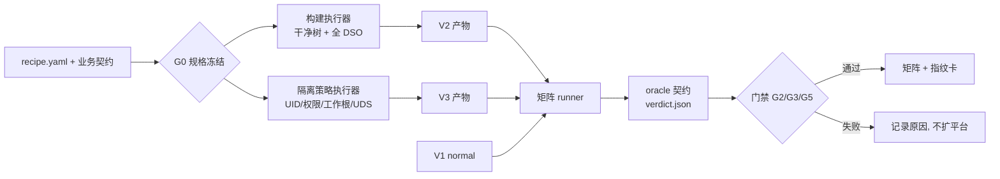

# V2/V3 自动化生成实现方案（单人可执行版）

> 状态：**设计稿 v1，未实现、未构建、未跑矩阵**。本文只规定"怎么生成、怎么验、什么条件下停"，不代表任何效果已达成。
> **口径更新（2026-11-03）**：本文"LLM 监管层首发不接""allocator 不进 V2 身份"的结论已被三 Agent 方案调整（A2 监管 Agent 与调度器主干同批设计；分配器进入 V2 候选轴）；其余构建纪律、业务契约、门禁与 go/no-go 仍有效。
> 上游依据：[系统架构设计 v2](历史/Qw9-Apache-系统架构设计-v2.md)（已归档）、[官方赛题逐段提取](核对材料/赛题原文-逐段提取.md)（P013–P023、P025–P031）、`Apache项目/CVE总览-Apache.md` 与 `cve/apache/build/build.sh`（本地工作区文件，未入库）。
> 本文同时**纠正架构 v2 §5.1 的一处错误表述**（见 §1.3）。

---

## 0. 一页结论

| 项 | 决定 |
|---|---|
| V2 是什么 | 加固编译栈：clang + `-O2` + `-D_FORTIFY_SOURCE=2` + `-fstack-protector-strong` + PIE + RELRO，**全部 DSO 同参数重编**；allocator 只作可选实验维度，不进 V2 身份 |
| V3 是什么 | 同业务能力下的**资源可达边界异构**：独立 UID、文件/目录权限矩阵、工作根隔离、UDS 目录收口。**不是源码修洞** |
| 生成器形态 | 单一 Python CLI（`qw9gen`）+ recipe 驱动的构建执行器 + 隔离策略执行器 + 三版本矩阵 runner |
| 硬门 | **第 5 天（11.13）**：44790 在统一普通 V1、同一 pad 请求下拿不到真实差异 → **NO-GO，不扩平台**，改为如实报两项 + 评估检测型候选 |
| 现在到 11.6 | 只做 P0 试制（约 1 天）：clang 能否构建 2.4.49、FORTIFY 是否真实生效、隔离在 WSL1 是否可行。**不建平台** |

---

## 1. 现状与约束

### 1.1 已具备的事实

| 项 | 现状 | 出处 |
|---|---|---|
| V1 | Apache httpd **2.4.49**，tarball sha256 `345d3b9b…2205` | `cve/apache/README.md`（本地） |
| 构建 | `build.sh [normal\|asan]`，`--with-apr=/usr`，`--enable-mods-shared=most` | `cve/apache/build/build.sh`（本地） |
| 漏洞 | 10/11 可直接打，11 个 CVE 覆盖 6 类 CWE | `Apache项目/CVE总览-Apache.md`（本地） |
| 环境 | WSL1 `Ubuntu-CTF`，Ubuntu 22.04，gcc 11.4，root，端口 8082 / 8090–8096 | 同上 |

### 1.2 必须先解决的四个工程债

1. **oracle 硬编码**：`verify.sh` 里 `PREFIX=/opt/httpd`、`PORT=8082`、`ROOT=/mnt/e/强网拟态/...` 写死，无法指向变体。→ 全部改成环境变量注入。
2. **V1 身份不清**：44790 用 `/opt/httpd-asan`，其余用 `/opt/httpd`。**不能把 ASAN 构建当 V1 或当 V2**，它是观察工具。→ 冻结 `V1 = normal 构建`，ASAN 另册。
3. **无干净构建树**：`build.sh` 复用已有 `Makefile` 与旧对象。→ 每配方从 tarball 重新解压，独立前缀。
4. **只验主程序**：漏洞代码在 DSO 里（`--enable-mods-shared=most`）。→ 必须记录并校验 `modules/*.so`。

### 1.3 三条必须纠正的说法（原稿与架构 v2 的问题）

| 原说法 | 问题 | 改为 |
|---|---|---|
| "V3 语义等价重构使逻辑型触发失效"（架构 v2 §5.1） | 真正等价的 AST 重构**不应改变**定义良好输入下的漏洞行为；改了就是修复 | V3 = 运行形态/资源边界异构；AST 重构列为二期演示，且**不承担阻断承诺** |
| "规范化重写/discard/rewrite 校验即等价重构" | 那是打补丁，属 P020"针对已知漏洞改源码"，不得作主要证据 | 明确禁用；补丁只能作对照实验，单列并标注 |
| "V2 制造崩溃/静默/泄露三态" | 44790 根因是 `vlen` 下溢 + `vlen+1` 回绕 → `memcpy(SIZE_MAX)` 或巨量分配 abort，**不是 1 字节落 slack**；FORTIFY 跨 APR 封装拿不到对象尺寸 | 只写"可能产生检测/故障边界差异"，**必须实测**；不预报三态 |

### 1.4 平台约束（WSL1）

WSL1 无真实 Linux 内核，namespace（`unshare`/netns/mount ns）支持不可靠，容器无法运行。

- V3 隔离**不得依赖 namespace**；用 UID/权限/目录可达性实现，`chroot` 需实测。
- 若 P0 实测 `chroot` 不可用 → V3 退化为"独立 UID + 权限矩阵 + 工作根路径隔离"，仍成立但表述收敛。
- 终版验收建议迁 WSL2 或容器（同时是"容器化交付"加分项）。

---

## 2. 目标与验收口径

**"自动化生成"的定义**：给定 `recipe.yaml`，一条命令输出可独立运行的变体（二进制 + 模块 + 配置 + 启动脚本）与 `manifest.json`，**全程不手改源码、不手改配置**。

| 验收项 | 通过标准 |
|---|---|
| 可重复 | 同 recipe 两次构建，产物哈希一致（允许 `-ffile-prefix-map` + `SOURCE_DATE_EPOCH` 后比对） |
| 可追溯 | manifest 记录编译器版本、完整编译命令、configure 行、种子、输入源码哈希 |
| 覆盖完整 | `httpd` + 每个 `modules/*.so` 都有独立哈希与编译参数 |
| 无手改 | 变体目录内源码与 V1 源码 diff 为空；差异只来自 recipe |
| 可运行 | 变体自检：`httpd -t` 通过、能起服务、业务契约通过 |

---

## 3. 总体架构



### 3.1 模块（只保留生成相关，砍掉 v2 的 M7 监管层首发）

| 模块 | 职责 | 不做 |
|---|---|---|
| M1 规格 | recipe/契约/允许资源清单校验、冻结、哈希 | 判定漏洞 |
| M2 构建 | 干净树、工具链、DSO 全量、manifest | 安全结论 |
| M3 隔离 | 生成 V3 的 UID/权限/目录/UDS 策略并落地 | 改源码 |
| M4 运行 | 统一起停、端口分配、日志、清理自有 PID | 全局 pkill |
| M5 裁决 | 跑 oracle、比三版本、出 verdict | 改证据 |
| M6 报告 | 矩阵、指纹、漂移 diff | 重判 |

LLM 监管层（架构 v2 的创新点一）留到 M4 之后再挂，**首发不接**，避免单点依赖。

### 3.2 目录布局

```text
platform/
  pyproject.toml
  src/qw9/
    domain/      recipe.py contract.py verdict.py
    build/       executor.py toolchain.py manifest.py
    isolate/     policy.py apply.py
    run/         launcher.py portpool.py
    judge/       oracle.py matrix.py
    cli.py
  recipes/
    v1-normal.yaml
    v2-hardened.yaml
    v3-isolated.yaml
  contracts/
    apache-business.yaml      # 冻结的业务能力清单
    apache-resources.yaml     # 允许资源清单
  tests/
artifacts/                    # 真实产物在 VM 外置, 不进 git
  V1/ V2/ V3/
  runs/<run_id>/
```

---

## 4. 变体配方

### 4.1 recipe 示例（V2）

```yaml
apiVersion: qw9/v1
kind: VariantRecipe
metadata:
  id: v2-hardened
  role: CANDIDATE
source:
  package: httpd-2.4.49.tar.gz
  sha256: 345d3b9b218b1974d1cebd5ae72f6a661d83b52d839310222ff9ec94abb62205
toolchain:
  cc: clang
  cc_min_version: "14"
  ld: lld
flags:
  cflags: "-O2 -g -fPIE -fstack-protector-strong -D_FORTIFY_SOURCE=2 -ffile-prefix-map=$SRC=."
  ldflags: "-pie -Wl,-z,relro,-z,now"
configure:
  args: ["--with-apr=/usr", "--with-apr-util=/usr", "--enable-mods-shared=most",
         "--enable-cgi", "--enable-cgid", "--enable-lua", "--enable-proxy",
         "--enable-proxy-http", "--enable-rewrite", "--enable-headers", "--enable-so"]
  env: { SOURCE_DATE_EPOCH: "1631836800" }
verify:
  require_fortify_symbols: true     # objdump -T | grep -E '__.*_chk$'
  require_stack_guard: true         # readelf -s | grep __stack_chk_fail
```

**allocator 不进 V2 身份**。需要探索时用独立 recipe `v2-jemalloc.yaml`，归入熵实验（轨道 E）候选池，不参与作品变体。

### 4.2 V3 隔离策略（声明式）

```yaml
apiVersion: qw9/v1
kind: IsolationPolicy
metadata: { id: v3-isolated }
runtime:
  user: httpd-v3
  group: httpd-v3
  server_root: /opt/qw9/v3
  workdir: /opt/qw9/v3
resources:                       # 白名单：只允许这些可达
  readable:
    - /opt/qw9/v3/htdocs
    - /opt/qw9/v3/icons
    - /opt/qw9/v3/cgi-bin
    - /opt/qw9/v3/lua
    - /opt/qw9/v3/conf
    - /usr/lib/apache2/modules   # DSO 依赖
    - /etc/passwd                # 业务契约要求可读（见下）
  writable:
    - /opt/qw9/v3/logs
    - /opt/qw9/v3/cgi-bin
    - /run/qw9/v3
  uds_allowed:
    - /run/qw9/v3/backend.sock
  denylisted_observable:         # 仅用于测试判定, 不是"防护"
    - /opt/qw9/markers/root-only.txt   # 0600 root, V1 可读 / V3 不可读
```

**关键设计点**：`/etc/passwd` 全世界可读，光降 UID **不能**让 41773 的文件读取消失。因此 41773 的差异轴必须换成**root-only 标记文件**（V1 以 root 运行可读，V3 以非 root 运行不可读）+ **命令执行身份**（root → 非特权）。这是真实、外部可观测、可复核的差异，且符合 P017"权限分离"，但**结论措辞必须是"利用受抑制/后果受限"，不是"漏洞消除"**。

### 4.3 业务契约（必须冻结，P023 硬要求）

```yaml
apiVersion: qw9/v1
kind: BusinessContract
capabilities:
  - id: static-file
    probe: "GET / HTTP/1.0 -> 200 且 body 含 lab 标记"
  - id: cgi-exec
    probe: "GET /cgi-bin/env.sh -> 200 且输出变量"
  - id: lua-parsebody
    probe: "POST /parsebody (合法 multipart) -> 200"
  - id: proxy-forward
    probe: "经代理取本地回环 HTTP 后端 -> 200 且内容一致"
  - id: proxy-reverse-uds
    probe: "声明的 UDS 后端 -> 200 且内容一致"
  - id: rewrite
    probe: "RewriteRule 正常路径重写 -> 200"
  - id: keepalive
    probe: "同连接两请求均 200"
```

**七个能力全部保留**是 V3 的硬约束：不许关 CGI/Lua/proxy/rewrite 来"造差异"。

---

## 5. 构建执行器要点

1. **每次构建独立干净树**：`tar xzf $TARBALL -C $TREE --strip-components=1`，禁止复用 `Makefile`/`.o`；`RECONFIGURE` 一律强制。
2. **全 DSO 覆盖**：构建后对 `bin/httpd` 与 `modules/*.so` 逐个 `sha256sum` + `readelf -p .comment` + `objdump -T | grep _chk`。
3. **FORTIFY 实证**：不接受"加了 `-D_FORTIFY_SOURCE=2` 就算加固"。必须证明 `__memcpy_chk`/`__sprintf_chk` 等符号出现在**目标模块**里；未出现记为"该模块未生效"。
4. **APR 边界**：`--with-apr=/usr` 意味着 APR 由 apt 提供、未加固。manifest 必须单列"APR/APR-util 来源与版本"，报告里不得把 httpd 的加固说成整栈加固。
5. **可重复**：`SOURCE_DATE_EPOCH` + `-ffile-prefix-map`；两次构建不一致时输出 diff 而不隐藏。
6. **端口与实例所有权**：每变体固定端口段（V1 8100、V2 8110、V3 8120，每个 CVE 偏移 +0..+9），只按记录的 PID 清理。

---

## 6. 矩阵 runner 与 oracle 契约

### 6.1 统一注入变量（消灭硬编码）

```bash
VARIANT_ID=v3 PORT=8120 PREFIX=/opt/qw9/v3 \
  ORACLE_OUT=artifacts/runs/$RUN_ID/v3/CVE-2021-41773 \
  bash poc/CVE-2021-41773/verify.sh
```

### 6.2 `verdict.json`（每格一份）

```json
{
  "schema": "qw9/verdict-v1",
  "run_id": "r-20261113-01",
  "variant": "v3", "cve": "CVE-2021-41773",
  "validity": "VALID",
  "goal_outcome": "GOAL_NOT_OBSERVED",
  "phenotypes": ["permission_denied"],
  "axes": {
    "out_of_bound_read": false,
    "command_executed": false,
    "exec_user": "httpd-v3"
  },
  "evidence": ["evidence/file_read_marker.txt", "evidence/error_log.txt"],
  "oracle_version": "41773-v2"
}
```

`validity` 只能是 VALID/INVALID/NOT_RUN；超时、OOM、起不来一律 INVALID，**不得计防御成功**。

### 6.3 三个计分 CVE 的 oracle 改法

| CVE | 现状问题 | 改为 |
|---|---|---|
| 41773 | 只 `grep uid=0(root)`，非 root 执行会被误判为"未触发" | 三轴：越界读 root-only 标记 / 命令是否执行 / 执行身份。任一变体差异都要能落到某一轴 |
| 44224 | A、B 混判，只算 1 根因 | 分轴：声明 UDS 可达 / 任意 UDS 可达。V3 预期"任意受阻、声明仍通" |
| 44790 | 硬指 `/opt/httpd-asan` | 统一普通 V1；同 pad 请求；真实差异（崩溃/检测信号/服务存活）先实测再写结论 |

### 6.4 防陈旧证据

- 每次运行先归档旧 `evidence/` 到 `archive/<run_id>/`；
- 判定前校验 `verdict.json` 的 `run_id` 与本轮一致；
- 二进制缺失即 FAIL，不允许"上次的证据"兜底。

---

## 7. 门禁与 go/no-go

| 门 | 检查 | 失败处理 |
|---|---|---|
| G0 规格冻结 | recipe/契约/资源清单哈希固定 | 不进入构建 |
| G1 环境 | 干净树、端口空闲、无宿主可写挂载 | 拒绝启动 |
| G2 功能一致性 | V2、V3 通过 §4.3 全部七项能力 | 候选淘汰 |
| G3 本轮对照 | V1 阳性、修复版阴性 | 该 CVE 暂停比较 |
| G4 差异成立 | 每个 CVE 至少一条真实外部差异 | 不够 3 个 → 见下 |
| G5 证据完整性 | run_id 一致、原件齐全、退出原因明确 | 记 INCONCLUSIVE |

### 第 5 天决策树（11.13）

```text
44790 是否出现真实差异？
├─ 是 → 继续，三漏洞组合成立，进入指纹卡与开销测量
├─ 否，但 V2 有可部署的检测型差异（如 ASan/池感知候选）
│      → 单列"检测型"，如实申明开销，不写"可用性改善"
└─ 否 → NO-GO
         ├─ 如实报 41773 + 44224 两项有效差异
         ├─ 不用补丁、不关业务凑数
         └─ 平台投入冻结，把时间转投文档与已有 10 个 CVE 的证据链
```

---

## 8. 排期

| 阶段 | 时间 | 交付 | 出口条件 |
|---|---|---|---|
| P0 试制 | 11.1–11.6（约 1 天机时） | clang 构建 2.4.49 通过；FORTIFY 符号实证；WSL1 隔离可行性结论 | 三个问题都有明确 yes/no |
| S1 骨架 | 11.9–11.11 | recipe schema、构建执行器、V1 与 V2 产物 | 一条命令出 V2 + manifest |
| S2 隔离 | 11.11–11.13 | V3 产物、七项业务契约全过 | G2 通过 |
| S3 矩阵 | 11.13–11.16 | 3 CVE × 3 变体 verdict、门禁判定 | **G4 决策点** |
| S4 收口 | 11.16–11.20 | 指纹卡、开销测量、矩阵报告 | 可供文档引用 |
| 可选 | 11.20–11.27 | 熵实验 K=8 子集、网关原型、容器化 | 有余力才做 |

第一阶段（到 11.6）文档里，V2/V3 仍写"设计已定义、实现待完成"，只把 P0 的实测结论作为可信度支撑。

---

## 9. 风险与回退

| 风险 | 概率 | 回退 |
|---|---|---|
| 44790 在 V2/V3 上都无差异 | 高 | 走 NO-GO，两项如实报；不扩平台 |
| WSL1 不支持 chroot/权限隔离 | 中 | 退化为"独立 UID + 权限矩阵 + 路径隔离"，表述收敛 |
| clang 14 编 2.4.49 报错 | 中 | 已备 gcc-12 作次选配方，记录差异 |
| FORTIFY 在 DSO 不生效 | 中 | 如实标注"该模块未覆盖"，不宣称整栈加固 |
| 评委质疑"配置差异不算异构" | 中 | 用 P017 原文（权限分离/隔离策略）+ 业务契约全过做回应 |
| 单人时间不够 | 高 | 优先保 P0→S2→S3，熵实验与网关直接砍 |

---

## 10. 明确不做

1. 不改源码修 CVE，不写路径规范化/discard/rewrite 校验当作"等价重构"；
2. 不关闭 CGI/Lua/proxy/rewrite/keepalive 造差异；
3. 不把 ASAN 构建当 V1 或 V2；
4. 不承诺 allocator 制造三态；
5. 不在拿到 G4 之前建监管 Agent、网关、容器；
6. 不宣称"漏洞消除"，只写"利用受抑制 / 后果受限 / 检测可见"。

---

## 附：与架构 v2 的差异清单

| 架构 v2 位置 | 本文处理 |
|---|---|
| §5.1"V3 语义等价重构使逻辑型触发失效" | 改为资源边界异构，AST 归二期 |
| §4.3 K=8~12 熵实验 | 降级为可选，S3 之后有余力再做 |
| §3 LLM 监管 Agent | 首发不接，留接口 |
| §10.2 M5 熵+量化 | 时间不够则砍，不影响 V2/V3 交付 |